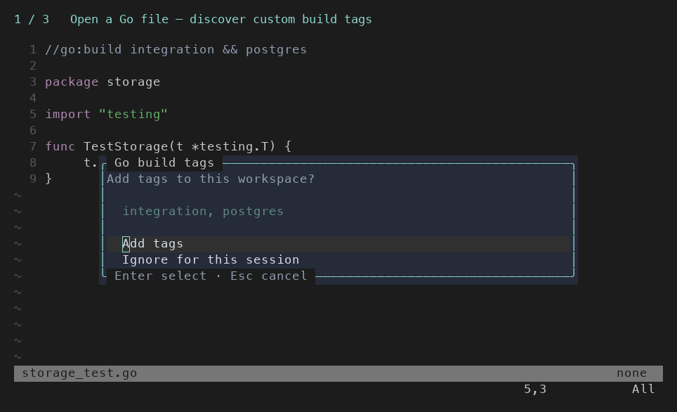

# go-context.nvim

Per-workspace Go build tags for Neovim. Save tags between sessions, apply them to
`gopls`, and get suggestions from `//go:build` directives. Contexts are stored
outside your repository.



## Installation

Requires **Neovim 0.10+**. For LSP integration, install and configure `gopls`
separately; the plugin does not install or start it.

With [lazy.nvim](https://github.com/folke/lazy.nvim):

```lua
{
  "nashabanov/go-context.nvim",
  lazy = false,
  config = function()
    require("go-context").setup()
  end,
}
```

With another plugin manager, install the plugin and call
`require("go-context").setup()`. No additional Lua dependencies or setup options.

## gopls integration

Add this field to your existing `gopls` configuration to load saved tags at startup:

```lua
before_init = require("go-context").before_init,
```

If you already have a `before_init` callback, call
`require("go-context").before_init(params, config)` at its end.

Context changes also update running `gopls` clients for the workspace. The plugin
replaces `-tags` in `settings.gopls.buildFlags`, preserving other flags.

## Usage

Open a Go file in a workspace:

| Command | Action |
| --- | --- |
| `:GoContext` | Edit the current tags in a floating input; Enter saves, Esc cancels |
| `:GoContext integration,smoke` | Replace tags (commas or spaces; duplicates removed) |
| `:GoContext!` or `:GoContextClear` | Clear tags and delete the saved context |

Entering a Go file with `//go:build integration && postgres` offers to add any
missing custom tags. Choose **Add tags** or **Ignore for this session** with
`j`/`k`, arrows, or Tab, then press Enter. Esc also ignores the suggestion.

Built-in platform/release tags and directly negated tags are excluded.
Expressions are not fully parsed: `postgres || sqlite` suggests both tags.
Only the current buffer is checked; tags are never removed automatically.

Workspaces are resolved from an attached `gopls` root, falling back to the nearest
`go.work` or `go.mod`. Tags persist under `stdpath("state")/go_context.nvim/`.
Go test, debugger, and linter commands are not modified.

## Lua API

```lua
local gc = require("go-context")

gc.tags() -- Current workspace's tags, or {} if unavailable.
gc.set({ tags = { "integration", "smoke" } })
gc.clear()

-- Optionally target a workspace explicitly.
gc.tags({ root = "/path/to/project" })
```

Use the `User GoContextChanged` event for custom integrations. See
[the full reference](doc/go-context.txt) or `:help go-context` for API options,
event data, suggestion rules, and storage behavior.

## Development

- `make check` — formatting checks and unit tests (requires StyLua and Neovim).
- `make fmt` — format Lua sources.
- `make smoke` — integration test with real `go` and `gopls` on PATH.

To regenerate the demo, run `uv run doc/record-demo.py` (requires Neovim and a
monospace font; set `DEMO_FONT` if needed).
